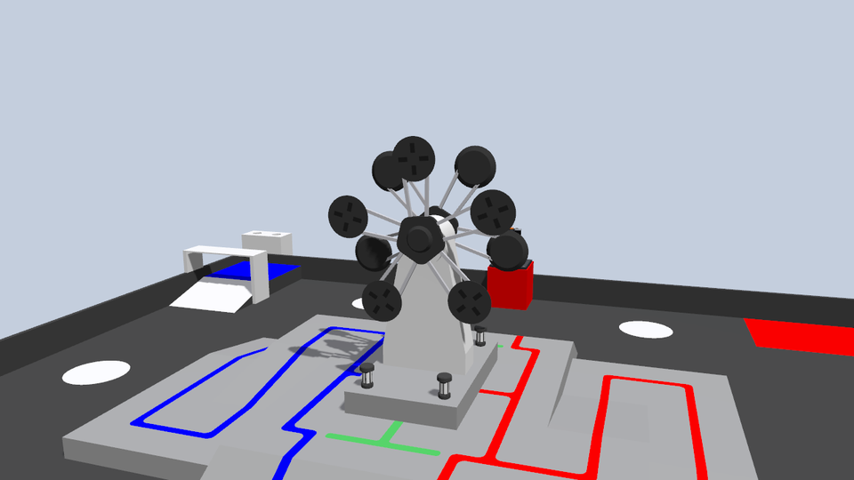

# robomini_sim（ROBOMINI 自瞄仿真平台）

Gazebo Harmonic + ROS 2 Jazzy

面向 ROBOMINI 机甲杯参赛队算法组的**自瞄测试平台**：在 Gazebo 中还原比赛场地与能量机关，
按规则实现灯效、命中判定与四阶段切换；提供 2 轴云台 + 乒乓球发射架。


## 环境依赖

| 依赖 | 版本 |
|---|---|
| Ubuntu | 24.04 |
| ROS 2 | Jazzy |
| Gazebo | Harmonic（gz-sim 8） |
| 编译 | cmake ≥ 3.16、C++17、g++ |
| 其他 | python3 |

## 构建

```bash
# 一键构建：Gazebo 系统插件 + ROS 2 工作区
scripts/build.sh

# 只构建部分 ROS 2 包
scripts/build.sh --packages-up-to robomini_sim
```

## 启动

```bash
source /opt/ros/jazzy/setup.bash
source ros2_ws/install/setup.bash
ros2 launch robomini_sim sim.launch.py                 # 无头（推荐服务器/远程）
ros2 launch robomini_sim sim.launch.py gui:=true       # 打开 Gazebo GUI（需要 DISPLAY）

# 渲染后端：默认 auto（检测到 NVIDIA GPU 时自动用 EGL/GPU）
ros2 launch robomini_sim sim.launch.py render_backend:=gpu
ros2 launch robomini_sim sim.launch.py render_backend:=cpu
```

常用 launch 参数：

| 参数 | 默认 | 说明 |
|---|---|---|
| `gui` | `false` | 是否开 Gazebo GUI |
| `side` | `blue` | 控制的一方（`blue` / `red`） |
| `control_mode` | `auto` | `auto`（自主，30/40/50/60 分）或 `manual`（人工，15/20/25/30 分） |
| `ammo_mode` | `unlimited` | `unlimited` 或 `counting`（按发球数限额） |
| `auto_advance` | `true` | 完成 5 靶后自动进入下一阶段 |
| `partition` | `robomini` | 多实例/多人并行时务必设置唯一值（`GZ_PARTITION`） |
| `world` | `worlds/robomini.sdf` | 世界文件路径 |
| `render_backend` | `auto` | `auto`（检测到 NVIDIA 用 GPU）/ `gpu` / `cpu` |

## 接口（ROS 2）

### 视觉 → 云台：`/vision_to_gimbal`（`robomini_interfaces/VisionToGimbal`）

| 字段 | 说明 |
|---|---|
| `mode` | `0` 不控制 / `1` 控制云台但不开火 / `2` 控制云台且开火 |
| `yaw`, `yaw_vel`, `yaw_acc` | 目标偏航角（rad）、角速度（rad/s）、角加速度（rad/s²） |
| `pitch`, `pitch_vel`, `pitch_acc` | 目标俯仰角、角速度、角加速度 |

### 云台 → 视觉：`/gimbal_to_vision`（`robomini_interfaces/GimbalToVision`）

| 字段 | 说明 |
|---|---|
| `mode` | `0` 空闲 / `1` 自瞄（仿真只输出这两个） |
| `q` | IMU 四元数，顺序 `w, x, y, z` |
| `yaw`, `yaw_vel` | 实测偏航角（rad）、角速度（rad/s） |
| `pitch`, `pitch_vel` | 实测俯仰角、角速度 |
| `bullet_speed` | 弹速（m/s；仿真取 `fire_speed`，默认 12） |
| `bullet_count` | 累计发弹数（`uint16`，会回绕） |

### 相机

| 类型 | 话题 | 说明 |
|---|---|---|
| `sensor_msgs/Image` | `/camera/image_raw` | 发射架相机 1280×720@60 Hz，与枪管同向 |
| `sensor_msgs/CameraInfo` | `/camera/camera_info` | 相机内参 |

## 常用调试命令

```bash
# 切换打靶模式（fixed / random_fixed / small / big）
ros2 service call /rune/set_mode robomini_interfaces/srv/SetRuneMode "{mode: small}"

# 强制推进阶段 / 复位机关 / 整体复位
ros2 service call /rune/next_stage std_srvs/srv/Trigger
ros2 service call /rune/reset      std_srvs/srv/Trigger
ros2 service call /sim/reset       std_srvs/srv/Trigger

# 看云台反馈 / 仿真状态
ros2 topic echo /gimbal_to_vision --once
ros2 topic echo /rune/state --once

# 手动控制云台（mode=1）或云台+开火（mode=2）
ros2 topic pub --once /vision_to_gimbal robomini_interfaces/msg/VisionToGimbal \
  "{mode: 1, yaw: 0.0, pitch: 0.2, yaw_vel: 0.0, yaw_acc: 0.0, pitch_vel: 0.0, pitch_acc: 0.0}"
```

## 仓库结构

```
robomini_sim/
├── worlds/robomini.sdf        # 正式世界
├── assets/models/             # 场地、能量机关、发射架、乒乓球（运行时资源）
├── gz_plugins/                # Gazebo C++ 系统插件（机关/灯效/命中/云台/发射）
├── ros2_ws/src/               # ROS 2 接口与节点（robomini_interfaces / robomini_sim）
├── scripts/                   # build.sh
├── demo/                      # 场地截图
└── README.md
```


## License

MIT，见 [LICENSE](LICENSE)。规则手册与比赛资料版权归华南虎机器人实验室所有。
